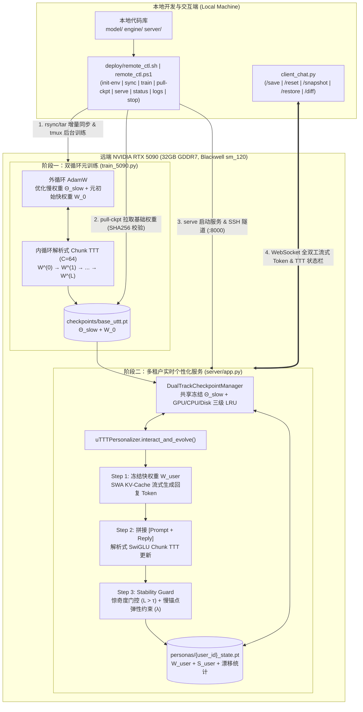

# uTTT: Universal Test-Time Training Framework for NVIDIA RTX 5090

完整的 **uTTT (Universal Test-Time Training) 远端元训练、自动化部署与交互式个性化推理框架**，针对单卡 **NVIDIA RTX 5090 (32GB GDDR7, Blackwell `sm_120`)** 进行算子级与显存级深度优化。

---

语言质量问题的根因、三阶段训练流程及实测 **15.84 亿参数**配置见 [语言训练说明](docs/language_training.md)。原“500M”默认模型实际约为 1.51 亿参数，名称已更正。

新语料来源、2026-10-29 最大模型训练计划、日志与停止/恢复方式见 [本轮训练记录](docs/training_run_20261029.md)。

## 2026-10-30 审计与训练状态

架构符合提示词的共享 Dense MSE 变体，已修复动态调度、元梯度、FP32 人格状态、保存与监控生命周期问题。当前 1.584B 任务仍处于预训练；`Surprise Loss=0` 是关闭 TTT 写入时的旧占位值，生成重复仍需质量验收。新版完整元训练容量必须重新测量。详见 [架构与训练审计](docs/architecture_audit_20261030.md)。

后续完成图缓存共享、零辅助损失反向剪枝、紧凑数据索引、full/best快照复用及WSL全局显存保护；实测范围与限制见 [本轮优化记录](docs/optimization_20261030.md)。

## 可靠性修复与兼容说明

- 人格自动保存现在按顺序完成原子落盘后才返回 `Persona Saved`，磁盘写入失败会返回错误。相比后台保存，每轮结束可能增加少量磁盘等待时间。
- 新人格文件与快照记录完整基础检查点的 SHA-256 指纹。已有的人格文件仍可通过旧签名读取，下一次保存时写入新指纹；旧格式缺少基础检查点指纹的快照保留在磁盘上，但不再自动恢复，以免将不同模型的人格混用。
- 用户 ID 和快照标签只接受英文字母、数字、`_`、`-`、`.`（不接受空值、`.`、`..`）。原先把特殊字符替换为下划线的方式会合并不同用户，现在直接返回校验错误。
- 新快照存放在 `personas/snapshots/{user_id}/{tag}.pt`，同名标签不可覆盖。以 `_state` 结尾的用户 ID 只写其规范人格文件，避免别名覆盖另一用户的数据。
- HTTP 与 WebSocket 的完整推理轮次在同一工作线程中串行执行，确保流式生成的线程状态及人格更新一致。无效 WebSocket 消息返回错误后仍可继续发送下一条消息。
- `remote_ctl.sh serve` 默认允许 300 秒预热，可用 `STARTUP_TIMEOUT=600 ./deploy/remote_ctl.sh serve --user-id Phova` 调整。应用启动失败会提前显示日志，SSH 隧道建立失败会返回非零退出码。
- 训练达到请求的总步数后，再次以相同数据和模型配置恢复时会直接返回已有检查点，不会重新训练并覆盖。指定但不存在或为空的数据集会明确报错。

验证命令：`python -m unittest discover -s tests -v`。部署脚本行为测试需要 Bash；Windows 原生 PowerShell 部署脚本另做语法检查。

## 1. 项目目录结构树 (Project Directory Structure)

```text
uTTT/
├── README.md                                 # 架构设计、完整操作手册与全套指令集参考
├── requirements.txt                          # Python 依赖声明 (PyTorch 2.6+, FastAPI, WebSockets, PyYAML)
├── .gitignore                                # Git 忽略规则 (排除 checkpoints/*.pt, personas/*.pt, .env 等)
├── .gitattributes                            # 跨平台换行符规范 (强制 *.sh 与 Dockerfile 使用 LF)
├── configs/
│   └── 5090_config.yaml                      # RTX 5090 (32GB, sm_120, BF16) 模型、内循环 TTT 与服务配置
├── model/
│   ├── __init__.py                           # 算子与模型组件导出
│   ├── uttt_layer.py                         # 跨层共享快权重池 (SharedFastWeightPool) + SwiGLU 解析式块状梯度 + 局部滑动窗口注意力
│   └── uttt_model.py                         # uTTTModel 主干网络 (跨层快权重状态传递 + Gradient Checkpointing + 流式生成)
├── engine/
│   ├── __init__.py                           # 个性化与 Checkpoint 引擎导出
│   ├── checkpoint_manager.py                 # 双轨制 Checkpoint 管理 (base_uttt.pt + personas/{user_id}_state.pt) 与三级 LRU 缓存
│   └── personalizer.py                       # uTTTPersonalizer (interact_and_evolve: 流式生成 -> Chunk TTT 更新 -> 惊奇度门控 + 弹性锚点)
├── server/
│   ├── __init__.py
│   └── app.py                                # FastAPI + WebSocket 流式推理与实时 TTT 个性化演化服务端
├── deploy/
│   ├── Dockerfile                            # 面向 Blackwell sm_120 / CUDA 12.8+ / PyTorch 2.6+ 的容器镜像定义
│   ├── prepare_dataset.py                    # 公开数据集 (Google Persona-Chat + BELLE 中文多轮) 自动拉取与格式化脚本
│   ├── setup_5090.sh                         # Linux / WSL2 远端 RTX 5090 驱动检测、环境构建与算子冒烟测试脚本
│   ├── setup_5090.ps1                        # Windows 10/11 原生远端 RTX 5090 环境构建与算子冒烟测试脚本
│   ├── remote_ctl.sh                         # Linux / WSL2 一键远端同步、数据集准备、tmux 训练、权重拉取与 SSH 隧道脚本
│   ├── remote_ctl.ps1                        # Windows 原生 PowerShell 一键远端同步、后台训练、权重拉取与隧道运维脚本
│   └── WIN10_WSL2_TAILSCALE_GUIDE.md         # 远端 Win10 专业版 (32GB RAM + RTX 5090) + WSL2 + Tailscale 专项部署指南
├── train_5090.py                             # RTX 5090 元训练脚本 (BF16 Autocast + torch.compile + 梯度累积 + Base Ckpt 导出)
├── client_chat.py                            # 交互式 CLI 客户端 (实时打印 TTT 状态栏 + /save /reset /snapshot /restore /diff 指令)
└── tests/
    └── test_uttt_pipeline.py                 # 端到端单元测试 (解析式梯度 vs Autograd 校验、跨层状态演化、双轨 Ckpt 与 Stability Guard)
```

---

## 2. 模块交互数据流图 (Module Interaction & Dataflow Architecture)



---

## 3. 核心算法解析：SwiGLU 快权重解析式块状梯度 (Analytical Chunk-wise Gradient)

在 `model/uttt_layer.py` 中，跨层共享快权重池 $\mathcal{W}_{\text{fast}} = \{W_{\text{up}}, W_{\text{gate}}, W_{\text{down}}\}$ 定义带 LayerNorm 残差的前向映射：

$$u_t = k_t W_{\text{up}}, \quad g_t = k_t W_{\text{gate}}, \quad h_t = \text{SiLU}(g_t) \odot u_t, \quad z_t = h_t W_{\text{down}}$$

$$\hat{v}_t = f_{\mathcal{W}}(k_t) = k_t + \text{LN}(z_t), \quad \mathcal{L}_{\text{TTT}}(\mathcal{W}; k_t, v_t) = \frac{1}{2} \|\hat{v}_t - v_t\|_2^2$$

对于长度为 $C$ 的分块 $K, V \in \mathbb{R}^{B \times C \times D}$，动态学习率加权上游误差为 $\tilde{\delta}_{\hat{V}} = \frac{\eta}{C} \odot (\hat{V} - V)$。通过解析式 LayerNorm 反向传播得到 $\delta_Z \in \mathbb{R}^{B \times C \times D}$ 后，三个快权重矩阵的块状梯度完全由 Tensor Core 批量矩阵乘法（`torch.bmm`）一次性算出：

$$\nabla_{W_{\text{down}}} = H^\top \delta_Z, \quad \delta_H = \delta_Z W_{\text{down}}^\top$$

$$\delta_U = \delta_H \odot \text{SiLU}(G), \quad \delta_G = \delta_H \odot U \odot \left[\sigma(G)\odot(1 + G\odot(1-\sigma(G)))\right]$$

$$\nabla_{W_{\text{up}}} = K^\top \delta_U, \quad \nabla_{W_{\text{gate}}} = K^\top \delta_G$$

随后执行 Frobenius 梯度范数裁剪与冲量/遗忘门更新：

$$S_t = \beta S_{t-1} - \text{clip}(\nabla_{\mathcal{W}}), \quad \mathcal{W}_t = (1 - \alpha_t)\mathcal{W}_{t-1} + S_t$$

---

## 4. 完整操作支持与指令集手册 (Full Command Reference)

### 4.1 远端连接环境变量配置 (`.env`)

在项目根目录创建 `.env` 文件（`remote_ctl.sh` 与 `remote_ctl.ps1` 均会自动加载）：

```ini
REMOTE_HOST=<YOUR_SERVER_IP>         # 远端服务器 IP / Tailscale IP / 域名 (必填)
REMOTE_PORT=22                       # 远端 SSH 端口 (默认: 22)
REMOTE_USER=<YOUR_SSH_USER>          # 远端 SSH 登录用户名 (默认: root)
REMOTE_DIR=/workspace/uTTT           # 远端工作区绝对路径 (WSL2/Linux 推荐 /workspace/uTTT)
SSH_KEY=${HOME}/.ssh/id_ed25519      # 本地 SSH 私钥路径
LOCAL_TUNNEL_PORT=8000               # 本地 SSH 隧道映射端口 (默认: 8000)
REMOTE_SERVICE_PORT=8000             # 远端 FastAPI 服务监听端口 (默认: 8000)
TMUX_TRAIN_SESSION=uttt_train        # 远端训练 tmux 会话名
TMUX_SERVE_SESSION=uttt_serve        # 远端推理服务 tmux 会话名
USE_DOCKER=0                         # 0: 使用远端 .venv 虚拟环境; 1: 使用 deploy/Dockerfile 容器
DOCKER_IMAGE=uttt-rtx5090:latest     # USE_DOCKER=1 时的镜像名称
```

---

### 4.2 远端自动化运维指令集 (`deploy/remote_ctl.sh` & `deploy/remote_ctl.ps1`)

#### A. Linux / WSL2 / Git Bash 指令集 (`deploy/remote_ctl.sh`)

| 子命令 | 完整调用示例 | 功能说明 |
| :--- | :--- | :--- |
| `init-env` | `./deploy/remote_ctl.sh init-env` | 自动探测远端 RTX 5090 驱动与 `sm_120` 架构、同步代码，并执行 `setup_5090.sh`（或构建 Docker 镜像）完成算子冒烟验证 |
| `sync` | `./deploy/remote_ctl.sh sync` | 基于 `rsync` 增量同步本地代码到远端（自动排除 `checkpoints/`、`personas/`、`data/`、`logs/`、`.git/`、`.venv/`） |
| `prepare-data` | `./deploy/remote_ctl.sh prepare-data` | 在远端服务器自动拉取并格式化公开数据集（`google/Synthetic-Persona-Chat` + `BelleGroup/multiturn_chat_0.8M`）至 `~/uTTT/data/uttt_persona_train.jsonl` |
| `train` | `./deploy/remote_ctl.sh train [额外参数]` | 同步最新代码，在远端后台 `tmux` 会话 `uttt_train` 启动 `train_5090.py`，并自动流式回传实时训练日志（按 `Ctrl+C` 仅断开本地日志查看，不中断远端训练） |
| `pull-ckpt` | `./deploy/remote_ctl.sh pull-ckpt` | 将远端训练产出的 `checkpoints/base_uttt.pt` 拉取回本地 `checkpoints/base_uttt.pt`，并自动比对远端与本地 SHA256 校验值 |
| `serve` | `./deploy/remote_ctl.sh serve [额外参数]` | 在远端后台 `tmux` 会话 `uttt_serve` 启动 `server.app`，等待 `/health` 就绪后自动建立本地 `localhost:8000 -> 远端:8000` 的 SSH 隧道 |
| `status` | `./deploy/remote_ctl.sh status` | 查看远端 RTX 5090 显存占用、GPU 利用率、温度、活跃 `tmux` 会话及已生成的 Checkpoint / Persona 文件列表 |
| `logs` | `./deploy/remote_ctl.sh logs [train\|serve]` | 实时挂载查看远端训练日志（`logs train`，默认）或推理服务日志（`logs serve`） |
| `stop` | `./deploy/remote_ctl.sh stop [train\|serve\|all]` | 终止远端后台训练会话（`train`）、推理服务会话（`serve`）或全部终止（`all`，默认） |
| `help` | `./deploy/remote_ctl.sh --help` | 打印完整命令帮助与当前生效的环境变量 |

#### B. 原生 Windows PowerShell 指令集 (`deploy/remote_ctl.ps1`)
若远端服务器未开启 WSL2 而是运行原生 Windows 10/11 Pro，可在本地 PowerShell 中执行对应命令：
```powershell
.\deploy\remote_ctl.ps1 init-env
.\deploy\remote_ctl.ps1 sync
.\deploy\remote_ctl.ps1 train --lightweight --steps 50
.\deploy\remote_ctl.ps1 status
.\deploy\remote_ctl.ps1 logs train
.\deploy\remote_ctl.ps1 stop train
.\deploy\remote_ctl.ps1 pull-ckpt
.\deploy\remote_ctl.ps1 serve
```

---

### 4.3 元训练脚本参数与指令集 (`train_5090.py`)

既可通过 `./deploy/remote_ctl.sh train [参数]` 远端调用，也可在服务器本地直接运行 `python train_5090.py [参数]`：

| 参数 | 类型 / 默认值 | 说明 |
| :--- | :--- | :--- |
| `--config` | `str` (`configs/5090_config.yaml`) | 指定 YAML 配置文件路径 |
| `--data-path` | `str` (`None`) | 指定外部训练语料路径（支持 `.jsonl` 含 `text`/`content` 字段或纯文本 `.txt`；不传则默认使用内置 `PersonaMetaDataset` 合成多轮偏好记忆数据） |
| `--output-ckpt` | `str` (`checkpoints/base_uttt.pt`) | 自定义导出的 Base Checkpoint 保存路径 |
| `--steps` | `int` (`2000`) | 覆盖配置文件中的总训练步数 `max_steps` |
| `--batch-size` | `int` (`4`) | 覆盖单步微批次大小 `micro_batch_size` |
| `--seq-len` | `int` (`1024`) | 覆盖训练序列长度 `seq_len`（按 `chunk_size=64` 自动分块） |
| `--lightweight` | `flag` (`False`) | 启用轻量级模型配置（`d_model=256, n_layers=4, d_ff=512, C=32`），用于快速冒烟测试 |

**常用训练指令示例**：
```bash
# 1. 快速冒烟验证（跑 50 步轻量模型，验证训练与 base_uttt.pt 导出）
./deploy/remote_ctl.sh train --lightweight --steps 50

# 2. 完整 RTX 5090 生产级元训练（默认 2000 步，每 200 步自动原子保存 base_uttt.pt）
./deploy/remote_ctl.sh train

# 3. 使用自定义 JSONL 数据集训练 5000 步
./deploy/remote_ctl.sh train --data-path /workspace/data/dialogues.jsonl --steps 5000 --batch-size 4 --seq-len 1024
```

---

### 4.4 交互式 CLI 客户端与斜杠控制指令集 (`client_chat.py`)

#### A. 客户端启动参数

| 参数 | 类型 / 默认值 | 说明 |
| :--- | :--- | :--- |
| `--user-id` | `str` (`alex`) | 当前会话的用户唯一标识，对应独立快权重文件 `personas/{user_id}_state.pt` |
| `--ws-url` | `str` (`ws://localhost:8000`) | 远端（或 SSH 隧道映射到本地）的 WebSocket 服务地址 |
| `--local` | `flag` (`False`) | 不连接 WebSocket 服务端，直接在本地进程内加载模型与 `uTTTPersonalizer` 进行交互 |
| `--lightweight` | `flag` (`False`) | 在 `--local` 冷启动无 Checkpoint 时使用轻量模型配置 |
| `--config` | `str` (`configs/5090_config.yaml`) | 本地模式使用的 YAML 配置文件路径 |
| `--base-ckpt` | `str` (`checkpoints/base_uttt.pt`) | 本地模式加载的 Base Checkpoint 路径 |
| `--personas-dir` | `str` (`personas`) | 本地模式保存用户个性化快权重状态的目录 |
| `--max-new-tokens`| `int` (`64`) | 每轮回复最大生成 Token 数 |
| `--temperature` | `float` (`0.7`) | 生成采样温度（`0.0` 为贪婪解码） |
| `--demo` | `flag` (`False`) | 自动执行一段预设多轮对话与 `/diff`、`/snapshot`、`/save` 演示脚本并退出 |

**客户端启动示例**：
```bash
# 1. 连接已通过 ./deploy/remote_ctl.sh serve 映射到本地 8000 端口的远端 5090 服务
python client_chat.py --user-id alex --ws-url ws://localhost:8000

# 2. 本地直连模式运行自动化多轮演示
python client_chat.py --local --lightweight --demo
```

#### B. 对话内交互式斜杠指令集 (In-Chat Slash Commands)

在 `client_chat.py` 的 `You (user_id) >` 提示符下，除正常输入对话文本外，可直接输入以下状态控制指令：

| 指令 | 语法 | 功能说明 |
| :--- | :--- | :--- |
| `/save` | `/save` | 立即将当前用户的快权重矩阵 $\mathcal{W}_{\text{user}}$ 与冲量缓存 $S_{\text{user}}$ 持久化至 `personas/{user_id}_state.pt`（同步更新 `personas/{user_id}.pt`） |
| `/reset` | `/reset` | 将当前用户的快权重与冲量缓存重置回 Base Checkpoint 的元初始状态 $\mathcal{W}_0$（清零累积偏移） |
| `/snapshot` | `/snapshot [tag]` | 保存当前阶段的人格快权重快照至 `personas/snapshots/{user_id}_{tag}.pt`（若省略 `tag` 则自动使用时间戳命名） |
| `/restore` | `/restore <tag>` | 从 `personas/snapshots/{user_id}_{tag}.pt` 恢复指定阶段的人格快权重快照到当前活跃 GPU 会话 |
| `/diff` | `/diff` | 计算并打印当前快权重相对于初始 $\mathcal{W}_0$ 的 Frobenius 范数偏移报告 $\Delta \|\mathcal{W}_{\text{user}} - \mathcal{W}_0\|_F$（含总体百分比及 `W_up`、`W_gate`、`W_down` 分项偏移） |
| `/help` | `/help` | 打印客户端支持的所有斜杠指令说明 |
| `/quit` / `/exit` | `/quit` | 自动触发一次 `/save` 持久化当前用户快权重状态并安全退出客户端 |

每轮对话或指令执行后，终端底部均会实时打印标准 TTT 状态栏：
```text
[TTT Status] Surprise Loss: 0.42 | Weight Drift from Base: 3.18% | Persona Saved
```

---

### 4.5 个性化推理服务端与 HTTP / WebSocket 接口集 (`server/app.py` & `serve [额外参数]`)

#### A. 服务端启动参数说明（适用于 `./deploy/remote_ctl.sh serve [额外参数]` 与 `python -m server.app`）

`./deploy/remote_ctl.sh serve` 会将所有额外参数透传给远端 `python -m server.app`，启动后台 `tmux` 会话 `uttt_serve`（自动完成 RTX 5090 `torch.compile` 算子融合与预热），并在前台建立本地 `localhost:8000 -> 远端:8000` 的 SSH 隧道：

| 参数 | 类型 / 默认值 | 说明 |
| :--- | :--- | :--- |
| `--user-id` | `str` (`""`) | 启动服务端时预先将指定用户的快权重状态 `personas/{user_id}_state.pt` 预热加载至 GPU 一级 LRU 显存池 |
| `--config` | `str` (`configs/5090_config.yaml`) | 指定服务端读取的 YAML 配置文件路径 |
| `--base-ckpt` | `str` (`checkpoints/base_uttt.pt`) | 指定共享慢权重与元初始快权重 $\mathcal{W}_0$ 的 Base Checkpoint 路径 |
| `--personas-dir` | `str` (`personas`) | 指定多租户个性化快权重持久化目录 |
| `--max-gpu-users` | `int` (`16`) | 覆盖 GPU 显存一级 LRU 活跃用户池最大并发容量 |
| `--max-new-tokens` | `int` (`96`) | 覆盖服务端默认单轮最大生成 Token 数 |
| `--temperature` | `float` (`0.7`) | 覆盖服务端默认采样温度 |
| `--surprise-threshold` | `float` (`0.015`) | 覆盖 Stability Guard 的惊奇度门控阈值 $\tau$（仅当 `Surprise Loss > τ` 时更新快权重） |
| `--no-compile` | `flag` (`False`) | 禁用服务端启动时的 `torch.compile(dynamic=True)` 算子融合（默认在 CUDA 上自动开启并预热） |
| `--lightweight` | `flag` (`False`) | 当无 Base Checkpoint 冷启动时使用轻量级回退模型配置 |
| `--host` | `str` (`0.0.0.0`) | 服务端监听地址（`remote_ctl.sh serve` 默认传入 `0.0.0.0`） |
| `--port` | `int` (`8000`) | 服务端监听端口（`remote_ctl.sh serve` 默认传入 `REMOTE_SERVICE_PORT`） |

**常用服务端启动与连接示例**：
```bash
# 1. 一键在远端 5090 启动推理服务（预热用户 Phova 的快权重与 Triton 算子）并建立本地 8000 端口 SSH 隧道
./deploy/remote_ctl.sh serve --user-id Phova

# 2. 自定义驚奇度门控阈值与单轮生成长度启动远端服务
./deploy/remote_ctl.sh serve --user-id Phova --surprise-threshold 0.015 --max-new-tokens 128

# 3. 保持上述隧道终端运行，另开一个本地终端启动交互式对话客户端
python client_chat.py --user-id Phova --ws-url ws://localhost:8000

# 4. 在服务器本地直接启动 FastAPI 服务端
python -m server.app \
  --host 0.0.0.0 \
  --port 8000 \
  --config configs/5090_config.yaml \
  --base-ckpt checkpoints/base_uttt.pt \
  --personas-dir personas \
  --user-id Phova
```

#### B. REST API 与 WebSocket 接口列表

1. **健康检查与显存/LRU 状态查询 (`GET /health`)**：
   ```bash
   curl http://localhost:8000/health
   ```
   返回当前模型名称、GPU 已分配/预留显存（GB）、GPU 活跃用户列表（`gpu_active_users`）及二级 CPU 缓存用户列表（`cpu_cached_users`）。

2. **同步对话与实时 TTT 演化 (`POST /v1/chat`)**：
   ```bash
   curl -X POST http://localhost:8000/v1/chat \
     -H "Content-Type: application/json" \
     -d '{"user_id": "alex", "prompt": "我是一名专注于 CUDA 算子优化的工程师，请记住我的偏好。", "max_new_tokens": 64, "temperature": 0.7}'
   ```

3. **执行斜杠状态控制指令 (`POST /v1/command`)**：
   ```bash
   curl -X POST http://localhost:8000/v1/command \
     -H "Content-Type: application/json" \
     -d '{"user_id": "alex", "command": "/diff"}'
   ```

4. **查询指定用户的快权重偏移详情 (`GET /v1/persona/{user_id}/diff`)**：
   ```bash
   curl http://localhost:8000/v1/persona/alex/diff
   ```

5. **全双工流式生成与 TTT 更新 (`WS /ws/chat/{user_id}`)**：
   - **客户端发送**：`{"prompt": "你好", "max_new_tokens": 64, "temperature": 0.7}`
   - **服务端流式推送**：
     - 连接就绪帧：`{"type": "session_ready", "user_id": "alex", "step": 4, "weight_drift_pct": 1.25}`
     - 流式 Token 帧：`{"type": "token", "content": "..."}`
     - 轮次结束 TTT 状态帧：`{"type": "ttt_status", "result": {"surprise_loss": 0.42, "weight_drift_pct": 3.18, "persona_saved": true, "status_bar": "[TTT Status] Surprise Loss: 0.42 | Weight Drift from Base: 3.18% | Persona Saved", ...}}`

---

### 4.6 端到端单元测试指令 (`tests/test_uttt_pipeline.py`)

运行内置单元测试套件，校验解析式 SwiGLU 块状梯度与 `torch.autograd.grad` 的数值等价性、跨层快权重状态演化、双轨 Checkpoint 导出/加载、多租户三级 LRU 卸载以及 Stability Guard 门控逻辑：

```bash
python -m unittest discover -s tests -p "test_*.py" -v
```
