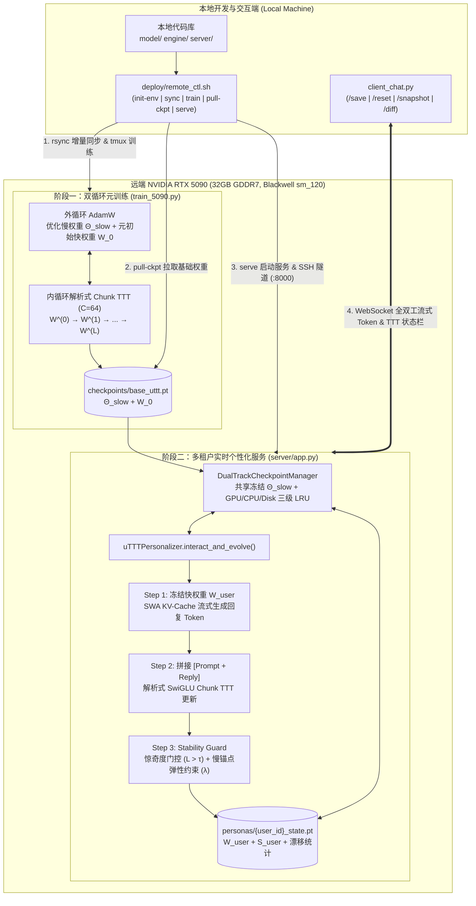

# uTTT: Universal Test-Time Training Framework for NVIDIA RTX 5090

完整的 **uTTT (Universal Test-Time Training) 远端元训练、自动化部署与交互式个性化推理框架**，针对单卡 **NVIDIA RTX 5090 (32GB GDDR7, Blackwell `sm_120`)** 进行算子级与显存级优化。

---

## 1. 项目目录结构树 (Project Directory Structure)

```text
uTTT/
├── README.md                       # 架构设计、目录结构树、数据流图与完整使用指南
├── requirements.txt                # Python 依赖声明 (PyTorch 2.6+, FastAPI, WebSockets, PyYAML)
├── configs/
│   └── 5090_config.yaml            # RTX 5090 (32GB, sm_120, BF16) 模型、内循环 TTT 与服务配置
├── model/
│   ├── __init__.py                 # 算子与模型组件导出
│   ├── uttt_layer.py               # 跨层共享快权重池 (SharedFastWeightPool) + SwiGLU 解析式块状梯度 + 局部滑动窗口注意力
│   └── uttt_model.py               # uTTTModel 主干网络 (跨层快权重状态传递 + Gradient Checkpointing + 流式生成)
├── engine/
│   ├── __init__.py                 # 个性化与 Checkpoint 引擎导出
│   ├── checkpoint_manager.py       # 双轨制 Checkpoint 管理 (base_uttt.pt + personas/{user_id}_state.pt) 与三级 LRU 缓存
│   └── personalizer.py             # uTTTPersonalizer (interact_and_evolve: 流式生成 -> Chunk TTT 更新 -> 惊奇度门控 + 弹性锚点)
├── server/
│   ├── __init__.py
│   └── app.py                      # FastAPI + WebSocket 流式推理与实时 TTT 个性化演化服务端
├── deploy/
│   ├── Dockerfile                  # 面向 Blackwell sm_120 / CUDA 12.8+ / PyTorch 2.6+ 的容器镜像定义
│   ├── setup_5090.sh               # 远端 RTX 5090 驱动检测、环境构建与算子冒烟测试脚本
│   └── remote_ctl.sh               # 一键远端同步、tmux 训练、Checkpoint 拉取与 SSH 隧道推理运维脚本
├── train_5090.py                   # RTX 5090 元训练脚本 (BF16 Autocast + torch.compile + 梯度累积 + Base Ckpt 导出)
├── client_chat.py                  # 交互式 CLI 客户端 (实时打印 TTT 状态栏 + /save /reset /snapshot /diff 指令)
└── tests/
    └── test_uttt_pipeline.py       # 端到端单元测试 (解析式梯度 vs Autograd 校验、跨层状态演化、双轨 Ckpt 与 Stability Guard)
```

---

## 2. 模块交互数据流图 (Module Interaction & Dataflow Architecture)



---

## 3. 核心算法解析：SwiGLU 快权重解析式块状梯度 (Analytical Chunk-wise Gradient)

在 `model/uttt_layer.py` 中，跨层共享快权重池 $\mathcal{W}_{\text{fast}} = \{W_{\text{up}}, W_{\text{gate}}, W_{\text{down}}\}$ 定義带 LayerNorm 残差的前向映射：

$$u_t = k_t W_{\text{up}}, \quad g_t = k_t W_{\text{gate}}, \quad h_t = \text{SiLU}(g_t) \odot u_t, \quad z_t = h_t W_{\text{down}}$$

$$\hat{v}_t = f_{\mathcal{W}}(k_t) = k_t + \text{LN}(z_t), \quad \mathcal{L}_{\text{TTT}}(\mathcal{W}; k_t, v_t) = \frac{1}{2} \|\hat{v}_t - v_t\|_2^2$$

对于长度为 $C$ 的分块 $K, V \in \mathbb{R}^{B \times C \times D}$，动态学习率加权上游误差为 $\tilde{\delta}_{\hat{V}} = \frac{\eta}{C} \odot (\hat{V} - V)$。通过解析式 LayerNorm 反向传播得到 $\delta_Z \in \mathbb{R}^{B \times C \times D}$ 后，三个快权重矩阵的块状梯度完全由 Tensor Core 批量矩阵乘法（`torch.bmm`）一次性算出：

$$\nabla_{W_{\text{down}}} = H^\top \delta_Z, \quad \delta_H = \delta_Z W_{\text{down}}^\top$$

$$\delta_U = \delta_H \odot \text{SiLU}(G), \quad \delta_G = \delta_H \odot U \odot \left[\sigma(G)\odot(1 + G\odot(1-\sigma(G)))\right]$$

$$\nabla_{W_{\text{up}}} = K^\top \delta_U, \quad \nabla_{W_{\text{gate}}} = K^\top \delta_G$$

随后执行 Frobenius 梯度范数裁剪与冲量/遗忘门更新：

$$S_t = \beta S_{t-1} - \text{clip}(\nabla_{\mathcal{W}}), \quad \mathcal{W}_t = (1 - \alpha_t)\mathcal{W}_{t-1} + S_t$$

---

## 4. 快速开始 (Quick Start)

### 4.1 远端 RTX 5090 一键部署与训练
```bash
export REMOTE_HOST="your.rtx5090.server.ip"
export REMOTE_PORT="22"
export REMOTE_USER="root"
export REMOTE_DIR="/workspace/uTTT"
export SSH_KEY="~/.ssh/id_ed25519"

# 1. 自动检测远端 RTX 5090 驱动并构建环境
./deploy/remote_ctl.sh init-env

# 2. 增量同步代码到远端服务器
./deploy/remote_ctl.sh sync

# 3. 远端 tmux 启动元训练并实时回传 Loss
./deploy/remote_ctl.sh train

# 4. 拉取训练完成的 Base Checkpoint 到本地
./deploy/remote_ctl.sh pull-ckpt

# 5. 启动远端 FastAPI+WebSocket 推理服务并建立本地 localhost:8000 SSH 隧道
./deploy/remote_ctl.sh serve
```

### 4.2 启动交互式个性化客户端
```bash
# 连接远端 SSH 隧道服务 (ws://localhost:8000)
python client_chat.py --user-id alex

# 或使用本地直连演示模式
python client_chat.py --local --lightweight --demo
```
每次对话后将实时输出状态栏：
```text
[TTT Status] Surprise Loss: 0.42 | Weight Drift from Base: 3.18% | Persona Saved
```
