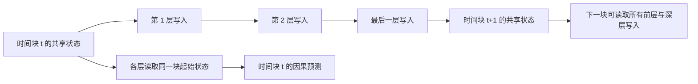

# 2026-10-30：架构、训练与运行维护审计

## 结论与边界

项目选择的是 `.prompt/MAIN-PROMPT.md`、`MODULE1.md` 至 `MODULE3.md` 描述的 **Dense SwiGLU + MSE 重构 + 共享快权重** 路线。主体结构符合这一设计，但旧实现的动态状态和元梯度存在实质缺陷，不能仅凭“只有一个 Pool 对象”认定跨层共享算法成立。本次已修复这些执行语义，并增加可复现回归。

这不是 `.prompt/2610.05484v1.pdf` 全部实验设置的逐项复刻。论文的关联损失、分头记忆、Muon、MoE 与主文 aggregated 写入等选择，和本项目提示词的 Dense MSE 顺序写入变体不同。当前只实现 causal sequential 调度；请求 `write_schedule=aggregated` 会明确报错，避免配置被静默忽略。

代码正确性与学会个性化是两项不同的验证。目前 1.584B 任务仍在语言预训练，随后进行 SFT；该流水线没有元训练阶段，在线 TTT 写入保持关闭。修复不能使旧检查点自动获得新能力。

## 对照提示词

| 要求 | 本次核查结果 |
|---|---|
| 顶层唯一的 W_up/W_gate/W_down，替代各层独立 FFN | 保留；每层独有慢投影，读取同一动态记忆 |
| 跨层、跨时间块共享写入 | 修复每层重置状态的问题，所有层顺序写同一游标，下一时间块可读到深层写入 |
| 因果语言建模 | 每块各层统一读取块起始快权重；本块写入仅影响后续块，防止当前块未来 token 泄漏 |
| SwiGLU 残差 LayerNorm 的 MSE 解析梯度 | 保留解析算子；移除导数/动量上的断图与直通近似，验证完整元梯度 |
| 动量、动态学习率和遗忘门 | W/S 用 FP32 主状态累积，BF16 用于矩阵读取与激活，避免小遗忘/小更新被舍入掉 |
| 局部 SWA + 全局记忆 | 保留；读写调度携带各层窗口 KV；目前输入掩码只支持右侧补齐 |
| 元训练后冻结慢权重，只更新用户状态 | 保留；新增 inner_loop_protocol 兼容检查，旧元训练和语言阶段检查点不能误开在线写入 |
| 惊奇度门控、梯度裁剪、弹性回拉和漂移上限 | 保留；补全 padding 不衰减动量、不污染惊奇度统计，非有限状态拒绝提交 |
| Base/Persona 双轨、LRU、快照和原子保存 | 修复保存失败时内存提前发布、跳过写入轮次未保存元信息、缓存保留被淘汰人格引用等问题 |
| 单卡 28 GiB 内运行 | 当前冻结读出预训练实测满足；新版完整元训练容量尚未重新测量，旧一阶结果不能作保证 |
| Persona 文件只有数十 MB | 最大模型不满足该体积预期：FP32 W/S 本身约 424.7 MB（405 MiB），另有约 106.2 MB BF16 读取缓存 |
| torch.compile 加速 | 保留可选编译并验证数值；当前正式训练采用已测更快的 eager 配置，避免把“启用编译”当作速度保证 |

MSE 可按有效 token 和维度归一化，受 `normalize_loss_by_dim` 控制；对应学习率也要随归一化方式标定。Surprise 不是通用的信息量或回答质量分数。

## 修复后的读写顺序



元训练与 `test_time_update` 复用同一执行路径；完整块重算保持跨块梯度与动量路径。`chunk_shared_fp32_exact_v1` 标记这一内循环协议。元训练恢复必须匹配协议；有意切换协议时，用新的输出路径和 `--init-from`，重新训练记忆能力。

## 当前训练的实际情况

审计读取的固定运行快照为 `runs/20261029_perf`，源码版本 `2680c84`。本次未停止或改写该快照，也未重置优化器或检查点。

- 总参数 1,583,879,748；语言阶段实际参与梯度的参数 1,137,973,760。另有 445,905,988 个 K/V、k_norm、eta/alpha 写入参数要在元训练中学习。
- 第 500 步验证 CE=6.1805，第 10000 步=3.5393，第 16000 步=3.3604，趋势持续下降；没有从这些日志发现发散或非有限损失。
- 第 16000 步名义累计 524,288,000 token，约训练 token 库的 14.6%；计数包含 BOS 等位置。100000 步计划约 3.277B token，约 0.914 个训练语料 epoch，不保证足够学习语言或指令。
- 正常训练日志约 7330 token/s；验证/大检查点保存附近速度下降，不能直接与稳定训练区间混为一谈。
- 贪婪续写存在明显重复，中文尤其突出，不能宣称质量已达标。预训练样例用于文章续写，尚不能检验指令遵循；验证 CE 下降也不能消除这一问题。
- 旧日志 `Surprise Loss: 0.0000` 是 `update_fast_weights=False` 的占位值。新代码明确打印阶段和 `Surprise Loss: disabled`，检查点同时记录是否实际测量。

新验证日志同时保留 greedy 与固定种子的随机采样，记录解码参数、生成长度、EOS 和重复指标；随机数状态在采样后恢复。该改动增强诊断，不会掩盖原始贪婪输出或修改训练目标。正在运行的旧快照继续输出原格式，可用无额外 GPU 占用的工具解析：

```bash
python deploy/diagnose_training.py --log logs/pretrain_20261029.log --stage pretrain --output logs/diagnosis_20261030.json
```

## 运行维护和恢复修复

`status 10` 的目标频率应为 100 Hz；旧版固定打印 5 Hz。新面板分别显示目标和实际刷新率，元信息每秒更新一次，GPU 采集使用本监控独占的进程组。关闭终端、SSH/PTY 断开、输出断管及 HUP/TERM/INT 都会回收自己的采集进程，不再每帧创建 `sleep` 等进程。日志查看也使用可回收的 SSH/PTY，关闭面板不终止训练。

已核实旧监控组 4331、16489、2253308 只包含 `bash -s`、相应监控采集或 `sleep`，随后定向清理，未匹配训练或其他日志查看进程。

训练检查点现在保存已消费的数据游标与 CPU/CUDA RNG；预取不提前提交进度。OOM 回滚并重放当前优化器步骤的样本；随机裁剪采用可恢复的单进程数据读取。旧检查点没有这些信息，恢复时明确提示无法精确延续样本顺序。损坏/不兼容检查点报错并保留文件，不会悄悄从随机权重覆盖。

停止训练只定位指定会话及工作目录内的流水线和主训练进程，保留 DataLoader 子进程供主进程完成当前步骤；使用启动时间与 pidfd 校验进程身份，拒绝误停其他工作目录的同名会话。新版训练器在完整优化器步骤边界保存后退出。取消异步服务请求时等待后台工作释放锁，健康检查不会被人格池锁阻塞。元训练 OOM 不再反复启用实际上未被新调度使用的旧 segment 开关。

## 后续优化优先级

1. **先验收语言和指令质量**：保留独立验证集，持续跟踪双路生成、重复和 EOS；SFT 后实测问答。根据验证/任务改善决定追加 token，不能用最大参数量替代训练预算。
2. **重新测量完整元训练容量**：新的精确梯度、FP32 状态和跨块图改变峰值显存。训练结束释放 GPU 后，再用带协议记录的 `profile_capacity.py` 做完整 Adam 步骤测量；需要时缩小元训练模型/序列，或评估优化器卸载与冻结部分慢权重。
3. **验证记忆带来的收益**：在超过 SWA 窗口的检索、用户纠正和偏好任务上，对比写入前后与 frozen baseline 的语言损失/任务准确率。阈值和漂移上限应由这一评估标定。
4. **压缩人格状态与写入成本**：评估分头、小型记忆池、低秩/增量状态，以及有数学定义的 aggregated 写入。它们会改变容量和学习行为，需要重新元训练及测量，不能当作无损开关。

本次已优化 FP32 人格的冻结读取缓存：按激活精度构建并跨层复用 BF16/FP16 读取副本，任一主权重修改/替换均失效；CUDA Graph 也使用读取副本，保留 FP32 主状态全部位。大模型新版元训练和这些结构性压缩优化尚未进行容量或质量验证。

## 验证

覆盖解析梯度与自动微分、有限差分、两步元梯度与裁剪、动量、BF16 小更新、跨层/跨块因果性、训练/在线调度一致性、重算梯度、混合批次 padding、磁盘失败回滚、LRU、协议兼容、断点精确恢复、OOM 重放，以及监控信号/断管/PTY 关闭与多监控隔离。

RTX 5090 主机的隔离目录执行 `OMP_NUM_THREADS=2 TORCHINDUCTOR_COMPILE_THREADS=2 .venv/bin/python -m unittest discover -s tests -q`：**129 项通过，0 跳过**，包含 CUDA Graph、BF16 编译训练、Linux SSH/PTY 回归；`bash -n deploy/remote_ctl.sh` 与差异检查通过。测试使用微型模型，未加载第二份正式大模型，也未对当前训练发停止信号。当前日志的只读诊断结果保存在 [训练诊断快照](training_diagnostics_20261030.json)。这不等于最大模型完整元训练容量或实际个性化效果已经验证。
